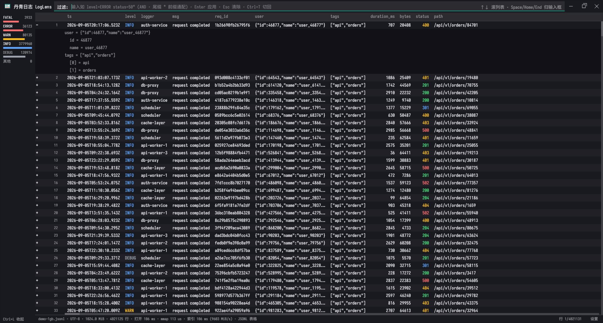

# 丹青日志 LogLens (danqing-log)

[](https://github.com/14uncle/danqing-log/releases/latest)
[](LICENSE-MIT)
[](#download)

**LogLens** — a fast large-file log & JSONL viewer for Windows, written in Rust.
Opens GB-scale files instantly (1 GiB indexed in 92 ms) with a virtualized scroll
view, tail-follow + live filtering, regex search with highlighting, and a JSONL
column view with nested expand and field filtering. Free & open source —
no account, no telemetry, nothing leaves your machine.

[English](#english) · [中文](#中文)

## English

**v1.0 free tier = full-featured single binary**, free & open source on GitHub forever.
Multi-file timeline merge, field analytics, export and workspace sessions belong to the
paid tier ($29 Personal / $59 Business perpetual), see
[`docs/ROADMAP-v1x.md`](docs/ROADMAP-v1x.md).



### Measured numbers

On 1 GiB files (release build, this machine, `logbench` headless benchmark; full report in
[`PERFORMANCE_REPORT.md`](PERFORMANCE_REPORT.md)):

| Metric | Plain log | JSONL |
|---|---|---|
| Index | 92 ms | 94 ms |
| Search (`ERROR`, case-insensitive by default) | 115 ms | 129 ms |
| Field filter (`level=ERROR`; `level=error` works the same) | — | 40 ms |
| Random access | 0.52 µs/line | 0.58 µs/line |
| Open (cold / warm) | ~600 ms / ~90 ms | same |

> Re-measured 2026-09-15 (warm cache). Since 2026-09-15 search is **case-insensitive by
> default** — about 1.6× slower than sensitive matching for short literals (`ERROR`:
> 71 → 115 ms); it runs on a background thread off the UI path, so you won't feel it.
> Write `(?-i)` in the pattern for exact matching. Open & index are unaffected
> (insensitivity only applies at query time).

The line index is a **stride table** (`memchr` SIMD scanning `\n`, absolute offset recorded
every `INDEX_STRIDE` lines, forward scan within a segment), not a per-line offset table —
≤ 16 MB of index memory for a 1 GB file (SPEC acceptance bound).

### How to choose among similar tools

One-line positioning: **klogg's speed × LogViewPlus's structure**.

- **vs klogg**: same mmap architecture, same speed class (no crushing claims). The gap is
  features & maintenance — klogg's latest release is over four years old and commits
  stopped 22 months ago (verified 2026-09-16), with no JSONL support.
- **vs LogViewPlus**: full-featured, but full parsing = a structural cost at open time
  (1 GiB cold start measured ~60 s on this machine), and it's paid commercial software.
  LogLens uses mmap + a virtualized viewport, which is structurally fast; v1.0 is
  fully free.
- **vs VS Code**: it can open these files but slowly — ~10 s for a 1 GiB plain log on
  this machine (2026-09-20); JSONL column view needs an extension (Daucloud measured
  ~7 s cold on the same file), and it occupies your editor and its resources.

> Full comparison tables with per-claim evidence dates:
> [PERFORMANCE_REPORT.md](PERFORMANCE_REPORT.md) and
> [DEEP_COMPETITIVE_RESEARCH.md](docs/DEEP_COMPETITIVE_RESEARCH.md);
> which items are parity, which are gaps, which are real innovations:
> [FEATURE-MATRIX.md](docs/FEATURE-MATRIX.md).

### Features

- **Open**: launch argument / `Ctrl+O` / drag onto the exe; async indexing keeps files
  over 1 GiB fully responsive, status bar shows `{pct}% · {done}/{total} MiB`;
  indexing is cancellable, and you can open another file while it runs
- **Scrolling**: row-anchored virtual viewport (no full line-offset table), no distortion
  across a 200-million-pixel domain
- **Search**: regex (`regex::bytes`, full-file scan), in-viewport highlighting +
  hit-by-hit navigation, capped at 1M hits; **case-insensitive by default** (`error`
  matches `ERROR`) — write `(?-i)error` for exact matching
- **Tail-follow**: 250 ms throttled polling, new lines appear within ≤1 s; scrolling up
  detaches, `End` resumes; external truncation / rotation rebuilds automatically (old
  content stays visible during rebuild); idle CPU < 1% when the file isn't growing
- **JSONL table**: auto-detected (first 64 lines sampled, ≥90% of non-empty lines must
  parse as JSON objects, no verdict under 3 lines) → column discovery (first 512 rows
  sampled, up to 16 columns) → columnar table; nested objects expand as sub-rows (`▶/▼`
  at line start, or `→`/`←`); the field-filter mini-syntax runs on a worker thread and
  never freezes the UI; if you don't remember the syntax, click **「字段…」** at the right
  end of the filter bar — pick field & operator, type only the value, multiple conditions
  are ANDed automatically; field names and values are **case-insensitive** (`LEVEL=error`
  ≡ `level=ERROR`); **column config trio**: drag the handle between columns to resize
  (double-click restores the sampled width) / drag headers to reorder (Esc aborts) /
  the header 「列…」 menu shows & hides columns (at least one stays) — remembered per file
  (`columns.json`), restored on reopen
- **Encodings**: UTF-8 (with BOM) / UTF-16 LE·BE (with or without BOM) / GBK (raw-byte
  index + per-line CP936 decode — Chinese text is searchable) / other single-byte
  encodings fall back to Latin-1

  
- **Level histogram**: left sidebar with 6 buckets (FATAL / ERROR / WARN / INFO / DEBUG /
  other) + log-scale bars — on a linear scale 4.54M INFO lines would crush 4,760 FATAL
  lines into sub-pixels, and the latter are the ones you're after. In JSONL mode, clicking
  a bar filters to that level (clickable rows give hover feedback); a `清除筛选`
  (clear filter) row at the sidebar bottom restores the full data; `Ctrl+L` collapses
  the sidebar (full shortcut list in the ⚙ settings card)
- **Selection & copy** (`Ctrl+C`): double-click selects tokens (timestamps / IPs /
  `level=ERROR` / paths / URLs are selected whole; English breaks on words, Chinese per
  character); drag for a character-level selection, across lines and across expanded
  sub-rows; copy resolves as **text selection > cell > selected row** — double-clicking
  a table cell copies its **full value** (unaffected by column-width truncation), a
  selected row copies the whole raw line, and inside an expand block a sub-row copies
  that sub-row's `label = value`
- **More**: level coloring (ERROR/WARN/INFO/DEBUG), bookmarks (`b`/`Ctrl+B`, remembered
  per file, kept separately per file across restarts), dark & light themes (settings
  card, instant effect, persisted to `config.toml`), system tray (right-click:
  Settings / Exit), clean empty state on launch, version check inside the settings card

### Download

- **GitHub Releases** (primary): [latest release](https://github.com/14uncle/danqing-log/releases/latest)
  — take `danqing-log-v<version>-win-x64.zip`, under 5 MB, unzip and run, no registry
  writes
- **Microsoft Store** (secondary): approved and listed 2026-09-21 (submitted 09-19);
  store page link TBD — the Store build is updated by the Store. Network behavior:
  **v1.0 makes zero network requests**; from v1.x the Store build queries the paid-tier
  license (via Windows Store services — the app itself still sends no HTTP), while the
  portable build's only network action is one update check at launch (see the
  [privacy policy](docs/privacy-policy.md))
- **Paid tier (v1.x, opened 2026-10-28)**: the free tier stays free forever
  (**personal, non-commercial use**; for work use please buy the paid tier — the line is
  "who pays": $29 Personal bought by yourself covers commercial use, $59/seat when an
  organization pays or reimburses; details in the [EULA](docs/eula.md)). The paid tier
  adds **new** batch / retention / delivery capabilities (see
  [`docs/ROADMAP-v1x.md`](docs/ROADMAP-v1x.md)): **multi-file timeline merge** (up to 8
  sources merged by timestamp, per-source clock-offset calibration, req_id cross-source
  tracing), **field analytics** (numeric quantiles / enum distributions), **export**
  (filtered results / pretty JSON / CSV), **workspace sessions** (filters / searches /
  column layout / expansion saved as named scenes), plus the column-config /
  bookmark-persistence / field-picker trio. Portable-build license keys verify offline,
  no network. **Buy** (Paddle-hosted checkout, WeChat / PayPal / cards):
  **[Personal $29](https://pay.paddle.io/hsc_01m5z030nhbajgmkj987wmbva9_c85re6taregcexaf8nzvc980w8np56r0)** ·
  **[Business $59/seat](https://pay.paddle.io/hsc_01m5z04yns6220j7jp385fdpwb_7fy2bhgj7jdyfq2z76gg3rb1rjs0nnw1)**
  — launch early-bird $19/$39 (until 2026-11-27 or the first 50 orders, auto-applied at
  checkout, no coupon needed); keys are issued manually, usually within 24 hours to the
  checkout email; 30-day no-questions refund. Receipts & order support via the
  [Paddle customer portal](https://customer-portal.paddle.com/cpl_01m49sdngv9g6vhtc1qday33mg)

> **Heads-up: the UI is currently Chinese-only.** Opening files (`Ctrl+O`), regex search
> and tail-follow work regardless of language; settings and dialogs are labelled in
> Chinese. An English UI is deliberately deferred until measurable overseas demand shows
> up (tracked openly: `docs/intent/i18n-deferral-2026-10-28.md`).

> System requirements: Windows 10 1809+ (x64), DirectX 12-compatible GPU. Both channels
> ship the same free tier with identical features.

### Usage

```bash
# GUI: open a log file (JSONL auto-detected → columnar table)
cargo run --release -- <path-to-log-file>

# Headless benchmark (open/index/search/filter/random-access numbers)
cargo run --release --bin logbench -- <log-file> [--filter "level=ERROR status=50*"] [regex...]

# Generate deterministic test data
cargo run --release --bin genlog -- out.log 1024            # 1 GiB plain log
cargo run --release --bin genlog -- out.jsonl 1024 --jsonl  # 1 GiB JSONL
```

Packaging: `powershell -NoProfile -File tools/package_portable.ps1` → `../release-archives/log/`

### Shortcuts

| Key | Action |
|---|---|
| Wheel / `↑` `↓` | Scroll |
| `PageUp` `PageDown` / `Space` | Page (`Shift` reverses) |
| `Home` / `End` | Jump to start / end (`End` also turns follow **on** — one-way, it never turns it off) |
| `Shift` + wheel | Horizontal scroll |
| `→` / `←` | Expand / collapse nested sub-rows of the selected line (table mode) |
| `/` | Focus the top bar (**raw mode**) |
| `Ctrl+F` | Focus the top bar (**any mode**: raw = search, table = filter) |
| `Enter` (bar empty) | Next hit (`Shift+Enter` previous) |
| `Ctrl+T` | Toggle raw / table mode (after JSONL is detected) |
| `b` / `'` | Toggle bookmark / jump to next bookmark (raw mode) |
| `Ctrl+B` / `Ctrl+G` | Same (any mode) |
| `f` | Follow **toggle** (raw mode) — on: stick to the tail; off: the view freezes |
| `Ctrl+O` | Open file |
| `Ctrl+C` | Copy — text selection if any, else the selected cell, else the selected row |
| `Ctrl+L` | Show/hide the level-histogram sidebar (persisted across sessions) |
| `Ctrl+E` | Export… (paid tier — filtered results / pretty JSON / CSV; free tier shows an upgrade prompt) |
| `Esc` | Close search bar / clear filter / close settings & upgrade & export popovers / clear selection |

When JSONL is detected, the file opens in table mode: just type into the filter box —
syntax `level=ERROR status=50*` (space-separated terms ANDed, trailing `*` for prefix
wildcard, bare words match whole-line substrings), `Enter` applies, `Esc` clears.
Field names and values are **case-insensitive by default** (`LEVEL=error` ≡ `level=ERROR`).

#### Three common misunderstandings

- **`f` and `End` are not equivalent** — `f` is a **toggle**: on → stick to the tail;
  **off → the view freezes**, new lines just pile up below without dragging you; `End` is
  **one-way** "jump to the tail + follow on" — pressing it never turns follow off. Both
  are only visible while the file is **being written** (on a static file `f` changes
  nothing on screen except a `· FOLLOW` marker in the status bar). "New lines" = lines
  other processes write into the log file; this viewer is read-only.
- **"Raw mode" is a view, not a file type** — a `.log` can only stay in raw mode
  (`Ctrl+T` does nothing: there's no schema to columnize); a `.jsonl` opens as a table
  and `Ctrl+T` switches between the two views. The same JSONL file thus has two faces.
- **While the top bar has focus, `Space` / `Home` / `End` belong to the input** (typing
  spaces, moving the caret), while `↑↓` still scroll the list — that's exactly what the
  bar's hint line says. Click the log list to move focus back; paging / jump-to-ends
  semantics return with it. (Settings live behind the gear at the right end of the
  status bar.)

### Known limits

- UTF-16 transcoding doubles memory (1 GB → ~500 MB copy); files >2 GB unverified
- JSONL column view only takes flat top-level fields; nested objects show as expandable
  sub-rows, not columns
- Search in GBK / Latin-1 files degrades to literals (no regex syntax)
- DEBUG/TRACE merge into one histogram row, so that row and "other" are **not clickable**
  (no single clause can express "DEBUG or TRACE"); in plain-text mode there's no field
  syntax and the bars are read-only
- Search hits are capped at 1M (the status bar notes the true total when capped)
- Bookmarks anchor to line numbers: if a file is rewritten in place without changing its
  line count, bookmarks point at wrong lines (no hashing); max 256 per file

### License

- **Source code**: MIT OR Apache-2.0
- **Official binaries & license keys**: under the [EULA](docs/eula.md) — free tier for
  personal / non-commercial use; paid tier is perpetual with a 30-day no-questions refund

---

## 中文

Windows 上的大文件日志 / JSONL 查看分析器 —— 丹青第四件产品。
GB 级文件秒开、虚拟化滚动、tail 跟随 + 实时过滤、正则搜索高亮、JSONL 列化 + 嵌套展开 + 字段过滤。

**v1.0 = 免费层单二进制全功能**，GitHub 永久免费开源。多文件时间戳合并、字段分析、导出、
工作台会话持久化属付费层（$29 个人 / $59 企业买断），见 [`docs/ROADMAP-v1x.md`](docs/ROADMAP-v1x.md)。


## 实测数字

1 GiB 实测（release，本机，`logbench` 无窗口基准；完整报告见
[`PERFORMANCE_REPORT.md`](PERFORMANCE_REPORT.md)）：

| 指标 | 明文日志 | JSONL |
|---|---|---|
| 索引 | 92 ms | 94 ms |
| 搜索 (`ERROR`，默认大小写不敏感) | 115 ms | 129 ms |
| 字段过滤 (`level=ERROR`，`level=error` 同效) | — | 40 ms |
| 随机访问 | 0.52 µs/行 | 0.58 µs/行 |
| 打开（冷 / 热） | ~600 ms / ~90 ms | 同 |

> 2026-09-15 复测（热缓存）。搜索行为 2026-09-15 起**默认大小写不敏感**，
> 比原来的敏感匹配慢约 1.6 倍（短字面 `ERROR`：71 → 115 ms）—— 这是 UI 之外的
> 后台扫描，体感无差；需要精确匹配时在模式里写 `(?-i)`。
> 打开与索引不受影响（不敏感只作用于查询期）。

行索引为**步进表**（`memchr` SIMD 扫 `\n`，每 `INDEX_STRIDE` 行记一个绝对偏移，段内前扫定位），
不是逐行偏移表 —— 1 GB 文件行索引内存 ≤ 16 MB（`SPEC` 验收上界）。

## 和同类工具怎么选

一句话定位：**klogg 的速度 × LogViewPlus 的结构化**。

- **对 klogg**：同为 mmap 架构，速度同档（不声称碾压）。缝在功能与维护 —— klogg 最近一次
  release 是四年多前、commit 停了 22 个月（2026-09-16 查证），无 JSONL 支持。
- **对 LogViewPlus**：功能全，但全量解析 = 打开慢的结构性代价（1 GB 冷启动本机实测约
  60 秒），且是付费商业软件。LogLens 走 mmap + 虚拟视口，结构性快；v1.0 全功能免费。
- **对 VS Code**：能开但慢 —— 1 GB 明文日志本机实测约 10 秒（2026-09-20）；JSONL 列化
  要靠扩展（Daucloud 同文件冷启动实测约 7 秒），还占着编辑器、吃编辑器资源。

> 完整对比表与逐项证据日期见 [PERFORMANCE_REPORT.md](PERFORMANCE_REPORT.md)「竞品对比」
> 与 [DEEP_COMPETITIVE_RESEARCH.md](docs/DEEP_COMPETITIVE_RESEARCH.md)；
> **哪些是对齐项、哪些是缺口、哪些是真创新**见
> [FEATURE-MATRIX.md](docs/FEATURE-MATRIX.md)。

## 功能

- **打开**：启动传参 / `Ctrl+O` / 拖到 exe 上；异步索引，1 GB 以上文件全程可响应，
  底栏显示 `{pct}% · {done}/{total} MiB`，索引中可取消或开另一个文件
- **滚动**：行锚定虚拟视口（不建全量行偏移表），2 亿像素域不失真
- **搜索**：正则（`regex::bytes`，全文扫描），可见区高亮 + 命中逐跳导航，上限 100 万条命中；
  **默认大小写不敏感**（`error` 命中 `ERROR`），要精确匹配把模式写成 `(?-i)error`
- **tail 跟随**：250 ms 节流轮询，新行 ≤1 s 出现；上滚自动脱离、`End` 恢复；
  外部截断 / 轮转自动重建（旧内容重建期间保持可见），无增长时空闲 CPU < 1%
- **JSONL 表格**：自动检出（采样前 64 行，非空行中 ≥90% 可解析为 JSON object，不足 3 行不判）
  → 列发现（采样前 512 行，上限 16 列）→ 列化表格；
  嵌套对象以子行展开（行首 ▶/▼ 或 `→`/`←`）；字段过滤迷你语法跑在工作线程，不冻界面；
  不记得语法就点过滤栏右端**「字段…」**：字段/算符点选、只打值，多条件自动 AND 追加；
  字段名与值**均默认大小写不敏感**（`LEVEL=error` 等价于 `level=ERROR`）；
  **列配置三件套**：列间手柄拖宽（双击恢复采样宽）/ 表头拖拽换位（Esc 放弃）/
  表头「列…」显隐（至少保留一列），按文件记住（`columns.json`），重开即恢复
- **编码**：UTF-8（含 BOM）/ UTF-16 LE·BE（有无 BOM 均可）/ GBK（原字节索引 + 行级 CP936 解码，
  中文可搜）/ 其余单字节编码 Latin-1 兜底

  
- **级别直方图**：左侧侧栏 6 桶计数（FATAL / ERROR / WARN / INFO / DEBUG / 其他）+ 对数刻度横条
  —— 线性刻度下 Info 454 万会把 Fatal 4760 压成亚像素，而后者才是要抓的那根。
  JSONL 模式下点柱条即筛出该级别（可点的行有 hover 反馈），侧栏底部出现 `清除筛选`
  可退回全部数据；`Ctrl+L` 收起侧栏（完整快捷键见设置卡 ⚙）
- **选区 / 复制**（`Ctrl+C`）：双击选词（时间戳 / IP / `level=ERROR` / 路径 / URL 整选，
  英文按单词断开，中文逐字）；拖动框选字符级、可跨行、可跨展开子行；
  取内容按 **「文本选区 > 单元格 > 行选中」** —— 表格双击单元格拿**完整值**
  （不受列宽截断省略影响），选中行拿整行原文，展开块里选子行拿该子行 `label = value`
- **其它**：级别着色（ERROR/WARN/INFO/DEBUG）、书签（`b`/Ctrl+B 夹书签，按文件记住，重启/换文件各记各的）、
  深浅主题（设置卡切换，即时生效且跨会话持久化，落 `config.toml`）、
  系统托盘（右键：设置 / 退出）、启动无参空态、设置卡含版本检查

## 下载

- **GitHub Releases**（主）：[最新版](https://github.com/14uncle/danqing-log/releases/latest)
  取 `danqing-log-v<版本>-win-x64.zip` —— 不到 5 MB，解压即用，不写注册表
- **Microsoft Store**（辅）：**已过审上架（2026-09-19 提交，09-21 认证通过）**，商店页链接待补 —— 商店版
  由商店代管更新。联网行为：**v1.0 零网络请求**；v1.x 起商店版会查询付费层购买授权
  （经 Windows 的商店服务，应用自身不发 HTTP），便携版唯一联网动作仍是启动时查一次
  新版本（见[隐私政策](docs/privacy-policy.md)）
- **付费层（v1.x，2026-10-28 开业）**：免费层永久免费不变
  （**限个人、非商业用途**；职务/商用请购付费层——分界是「谁出钱」：个人自购 $29 可商用，
  组织出资/报销 $59/seat，详见 [EULA](docs/eula.md)）；
  付费层是**新增**的批量 / 留存 / 交付能力（见
  [`docs/ROADMAP-v1x.md`](docs/ROADMAP-v1x.md)）。腿 = **多文件时间线合并**（最多 8 源
  按时间戳归并、req_id 跨源追踪）、**字段分析**（数值分位数 / 枚举分布）、
  **导出**（过滤结果 / JSON 美化 / CSV）、**工作台会话**（过滤/搜索/摆列/展开
  一键保存切换排障现场），另含列配置 / 书签持久化 / 字段点选查询三连；
  便携版 license key 离线校验不联网。**购买**（Paddle 托管收银台，微信 / PayPal / 卡）：
  **[Personal $29](https://pay.paddle.io/hsc_01m5z030nhbajgmkj987wmbva9_c85re6taregcexaf8nzvc980w8np56r0)** ·
  **[Business $59/seat](https://pay.paddle.io/hsc_01m5z04yns6220j7jp385fdpwb_7fy2bhgj7jdyfq2z76gg3rb1rjs0nnw1)**
  ——开业早鸟 $19/$39（至 2026-11-27 或前 50 单先到为准，checkout 页自动减、无需优惠码）；
  key 人工签发，通常 24 小时内发至结账邮箱；30 天无理由退款。收据/订单售后走
  [Paddle 客户门户](https://customer-portal.paddle.com/cpl_01m49sdngv9g6vhtc1qday33mg)

> 系统要求：Windows 10 1809+（x64）、DirectX 12 兼容显卡。两个渠道是同一个免费层，功能一致。

## 用法

```bash
# GUI: 打开日志文件 (JSONL 自动检出 → 列化表格)
cargo run --release -- <日志文件路径>

# 无窗口基准 (打开/索引/搜索/过滤/随机访问实测表)
cargo run --release --bin logbench -- <日志文件> [--filter "level=ERROR status=50*"] [正则...]

# 生成测试数据 (确定性)
cargo run --release --bin genlog -- out.log 1024            # 1 GiB 明文日志
cargo run --release --bin genlog -- out.jsonl 1024 --jsonl  # 1 GiB JSONL
```

打包：`powershell -NoProfile -File tools/package_portable.ps1` → `../release-archives/log/`

## 快捷键

| 键 | 作用 |
|---|---|
| 滚轮 / `↑` `↓` | 滚动 |
| `PageUp` `PageDown` / `空格` | 翻页（`Shift` 反向） |
| `Home` / `End` | 跳头 / 跳尾（`End` 跳尾并**开**跟随 —— 单向，不会把它关掉） |
| `Shift` + 滚轮 | 横向滚动 |
| `→` / `←` | 展开 / 折叠选中行的嵌套子行（表格模式） |
| `/` | 聚焦顶栏（**原始模式**） |
| `Ctrl+F` | 聚焦顶栏（**任意模式**：原始 = 搜索，表格 = 过滤） |
| `Enter`（栏空时） | 下一条命中（`Shift+Enter` 上一条） |
| `Ctrl+T` | 原始 / 表格模式互切（JSONL 检出后） |
| `b` / `'` | 切换书签 / 跳下一书签（原始模式） |
| `Ctrl+B` / `Ctrl+G` | 同上（任意模式） |
| `f` | 跟随**开关**（原始模式）—— 开则跟到底，关则画面钉住 |
| `Ctrl+O` | 打开文件 |
| `Ctrl+C` | 复制 —— 有文本选区拿选区，否则拿选中单元格，再否则拿选中行 |
| `Ctrl+L` | 级别直方图侧栏显隐（跨会话保持） |
| `Ctrl+E` | 导出…（付费层 —— 过滤结果 / JSON 美化 / CSV；免费态弹升级提示） |
| `Esc` | 关搜索栏 / 清过滤 / 关设置卡·升级提示·导出菜单 / 清选区与单元格选中 |

JSONL 检出后开局即表格模式：直接打字进过滤框，语法 `level=ERROR status=50*`
（空格分词 AND，尾缀 `*` 前缀通配，裸词整行子串），`Enter` 应用，`Esc` 清除。
字段名与值**默认大小写不敏感**（`LEVEL=error` 等价于 `level=ERROR`）。

### 三处容易误解的

- **`f` 与 `End` 不等价** —— `f` 是**开关**：开 → 跟到底，**关 → 画面钉住**，新行只往下堆、
  不再拽你；`End` 是**单向**的「跳到底 + 开跟随」，按几次都不会把跟随关掉。
  两者都只在**文件正在被写入时**才有可见效果（静态文件按 `f` 屏幕上什么都不会变，
  只是状态栏多出 `· FOLLOW`）。「新行」= 别的进程写进这个日志文件的行，本查看器只读。
- **「原始模式」是视图，不是文件类型** —— `.log` 只可能停在原始模式
  （`Ctrl+T` 对它无效：没有可列化的 schema）；`.jsonl` 打开即表格，`Ctrl+T` 可在
  两种视图间来回切。同一个 JSONL 文件因此有「表格」和「原始」两副面孔。
- **顶栏持焦时 `Space` / `Home` / `End` 归输入框**（输入空格、移光标），而 `↑↓` 仍滚列表 ——
  栏上那行 `↑↓ 滚列表 · Space/Home/End 归输入框` 写的就是这件事。
  点一下日志列表区即可把焦点挪回去，翻页 / 跳首末的语义随之回来。
设置入口在状态栏右下角齿轮。

## 已知边界

- UTF-16 转码副本内存翻倍（1 GB → 约 500 MB 副本）；>2 GB 文件未验证
- JSONL 列化只认扁平顶层字段；嵌套对象以子行展开看，不进列
- GBK / Latin-1 文件搜索退化为字面量（无正则语法）
- 直方图的 DEBUG/TRACE 合并为一行，故该行与「其他」行**不可点**（无单子句能表达
  「DEBUG 或 TRACE」）；纯文本模式没有字段过滤语法，柱条一律只读
- 搜索命中上限 100 万条（超出时底栏标注总命中数）
- 书签按文件行号锚定：文件被原地改写而行数不变时书签会指错行（不哈希校验）；
  每文件上限 256 条

## 许可

- **源代码**：MIT OR Apache-2.0
- **官方二进制与 license key**：适用 [EULA](docs/eula.md) —— 免费层限个人 /
  非商业用途；付费层买断制、30 天无理由退款
